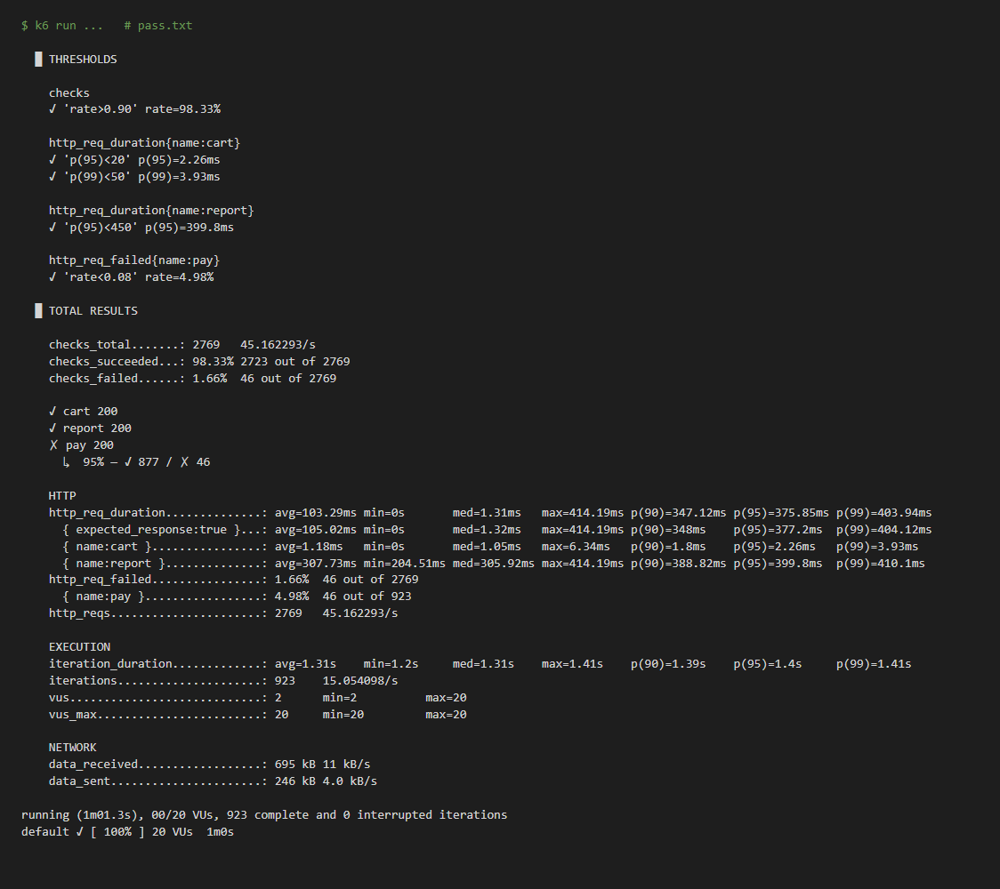
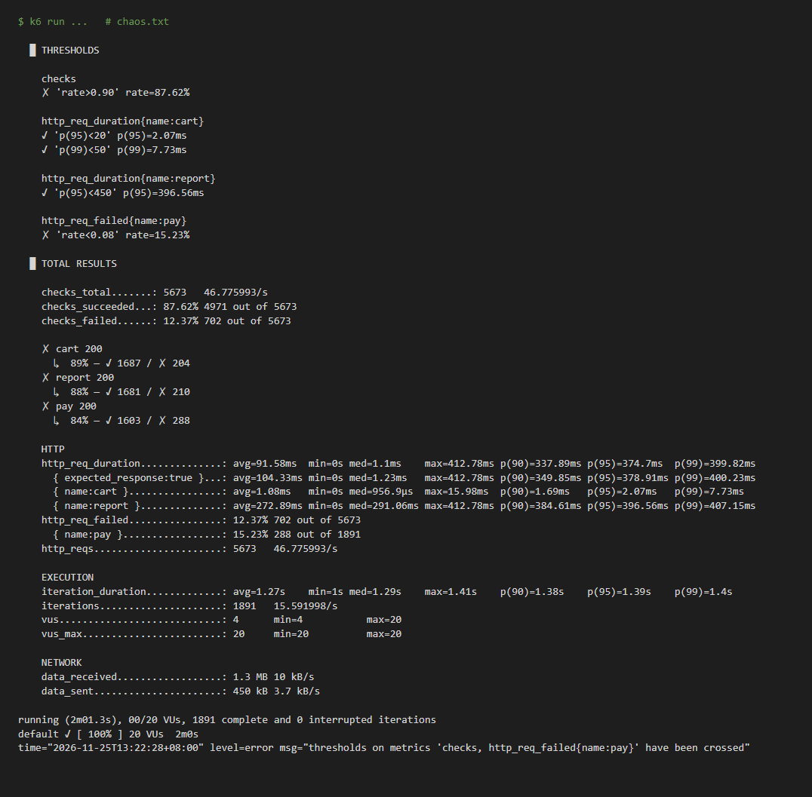
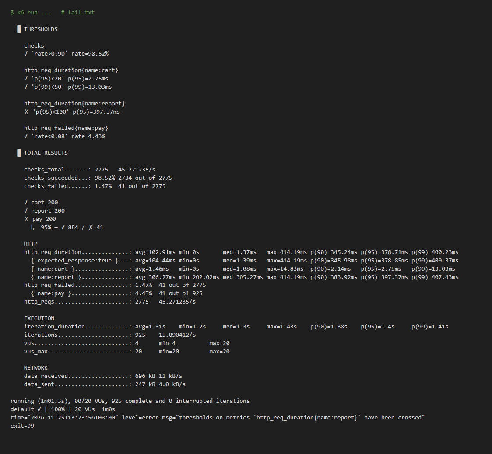
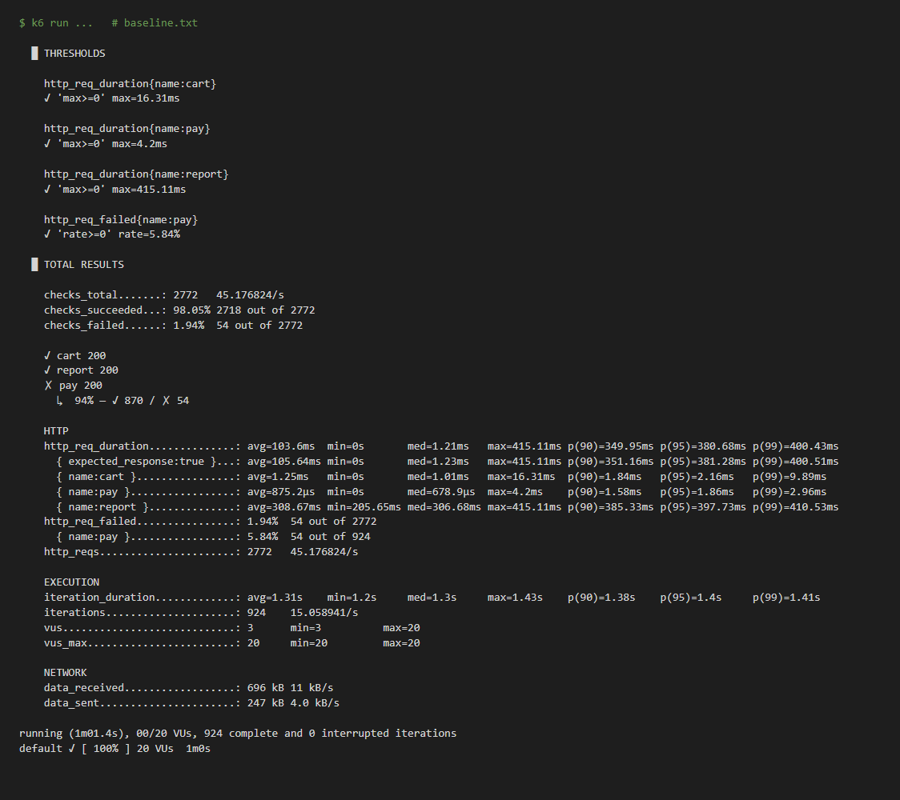

# Лаборатори №3: Чанарын сценарио → SLO → k6 threshold

F.CSA313 — 2026

- **Оюутан:** Ө.Манлайбаяр
- **Код:** B222270080

```
$ k6 version
k6.exe v2.4.0 (commit/dd9395906d, go1.26.11, windows/amd64)
```

**Орчин:** Windows 11, Node.js v24.20.0 + Express 5, Grafana k6 v2.4.0. Бүх тестийг зөвхөн өөрийн машин дээрх `http://localhost:3000` руу хийсэн.

## 1. Чанарын сценарио (6 хэсэгтэй формат)

Ачааллын тодорхойлолт (бүх сценариод ижил): **20 VU**, VU бүр давталт бүртээ `/cart/add` → `/report` → `/pay` гэсэн 3 хүсэлт илгээгээд 1с хүлээнэ. Суурь хэмжилтээр энэ нь ≈15 давталт/с, өөрөөр хэлбэл endpoint тус бүрт ≈15 хүсэлт/с, нийт ≈45 хүсэлт/с (`results/baseline.txt`: `http_reqs 45.176824/s`).

### 1.1 Performance сценарио — `/cart/add`

| Хэсэг | Агуулга |
|---|---|
| Тойм | Хэрэглэгч бараа сагсанд нэмэхэд систем хурдан хариулах ёстой. |
| Системийн төлөв | API хэвийн ажиллаж байгаа, дулаарсан (warm), бусад endpoint-ууд зэрэг ачаалал авч байгаа. |
| Орчны төлөв | Хэвийн ачаалал: 20 зэрэг хэрэглэгч (VU), `/cart/add` руу ≈15 хүсэлт/с, нийт ≈45 хүсэлт/с; локал сүлжээ. |
| Гадаад өдөөлт | Хэрэглэгч `POST /cart/add` хүсэлт илгээнэ. |
| Шаардлагатай хариу | Систем HTTP 200 ба `{ok:true}` хариу буцаана. |
| Хэмжүүр | 1 минутын цонхонд хүсэлтийн **95% нь 20мс-ээс**, **99% нь 50мс-ээс** бага хугацаанд хариулагдана (p95 < 20мс, p99 < 50мс). |

### 1.2 Reliability сценарио — `/pay`

| Хэсэг | Агуулга |
|---|---|
| Тойм | Хэрэглэгчийн төлбөрийн үйлдэл найдвартай амжилттай болох ёстой. |
| Системийн төлөв | API хэвийн ажиллаж байгаа; гадаад төлбөрийн gateway хааяа (≈5%) timeout өгдөг. |
| Орчны төлөв | Хэвийн ачаалал: 20 VU, `/pay` руу ≈15 хүсэлт/с. |
| Гадаад өдөөлт | Хэвийн хэрэглэгч `POST /pay` төлбөрийн хүсэлт илгээнэ (хэвийн хэрэглээ, эвдрэл биш). |
| Шаардлагатай хариу | Төлбөр амжилттай бол HTTP 200 `{paid:true}`; амжилтгүй бол 500 алдааг хэрэглэгчид ойлгомжтой буцаана. |
| Хэмжүүр | 1 минутын цонхонд `/pay` хүсэлтийн бүтэлгүйтлийн магадлал (POFOD = амжилтгүй хүсэлт / нийт хүсэлт) **8%-иас бага** — өөрөөр хэлбэл санамсаргүй төлбөрийн хүсэлт ≥ 92% магадлалтай амжилттай болно. |

### 1.3 Availability сценарио — сервер унаж, дахин асах

| Хэсэг | Агуулга |
|---|---|
| Тойм | Сервер гэнэт зогсоод (crash) дахин асахад үйлчилгээ хурдан сэргэж, нийт хүртээмж хүлээн зөвшөөрөгдөх түвшинд байх ёстой. |
| Системийн төлөв | API хэвийн ажиллаж, 20 VU-ийн ачаалал авч байх үед процесс гэнэт зогсоно. |
| Орчны төлөв | Хэвийн ачаалал (20 VU, ≈45 хүсэлт/с), 2 минутын тест, сервер зогсоход хүсэлт ирсээр байна. |
| Гадаад өдөөлт | **Эвдрэл (crash):** сервер процесс зогсоно (Ctrl+C / kill), ≈10 секундын дараа гараар дахин ажиллуулна. |
| Шаардлагатай хариу | Зогсолтын үед клиент алдаа (connection refused) авна; сервер асмагц нэмэлт гар ажиллагаагүйгээр хүсэлтүүд дахин амжилттай болно. |
| Хэмжүүр | 2 минутын цонхонд бүх хүсэлтийн амжилтын хувь (availability) **≥ 90%**; сэргэх хугацаа (MTTR) **≤ 12 секунд** (сервер унаснаас эхний амжилттай хариу хүртэл). |

### 1.4 Нэмэлт (4 дэх) performance сценарио — `/report`

| Хэсэг | Агуулга |
|---|---|
| Тойм | Тайлан гаргах endpoint нь удаан ч тодорхой хугацаанд багтах ёстой. |
| Системийн төлөв | API хэвийн; тайлан нь 200–400мс боловсруулалт шаарддаг. |
| Орчны төлөв | 20 VU, `/report` руу ≈15 хүсэлт/с. |
| Гадаад өдөөлт | Хэрэглэгч `GET /report` хүсэлт илгээнэ. |
| Шаардлагатай хариу | HTTP 200, 20000 мөртэй тайлан. |
| Хэмжүүр | 1 минутын цонхонд хүсэлтийн **95% нь 450мс-ээс** бага хугацаанд хариулагдана (p95 < 450мс). |

**"Сайн сценариогийн 5 шинж"-ээр шалгасан нь:** *итгэмжтэй* — тоонууд суурь хэмжилт болон серверийн кодоос (5% алдаа, 200–400мс) гарсан; *үнэ цэнэтэй* — сагс, төлбөр, хүртээмж нь хэрэглэгчид шууд нөлөөлдөг; *тодорхой* — endpoint, ачаалал (VU, хүсэлт/с), цонх нэрлэгдсэн; *нарийн* — хэмжүүр нь p95/p99 эсвэл магадлалаар, тоон босготой; *ойлгомжтой* — 6 хэсэг тус бүр нэг санаатай.

## 2. SLO хүснэгт

| Сценарио | SLI (юуг хэмжих) | Босго | Цонх / нөхцөл | k6 threshold (`slo-test.js`) |
|---|---|---|---|---|
| Performance | `/cart/add` хариу хугацаа | p95 < 20мс, p99 < 50мс | 20 VU тогтмол ачаалал, 1 мин | `'http_req_duration{name:cart}': ['p(95)<20', 'p(99)<50']` |
| Reliability | `/pay` error rate (POFOD) | < 8% | 20 VU, 1 мин | `'http_req_failed{name:pay}': ['rate<0.08']` |
| Availability | бүх хүсэлтийн амжилтын хувь (checks) | > 90% | 20 VU, 2 мин, 10с зогсолт орсон | `'checks': ['rate>0.90']` |
| Performance (нэмэлт) | `/report` хариу хугацаа | p95 < 450мс | 20 VU, 1 мин | `'http_req_duration{name:report}': ['p(95)<450']` |

**Босго сонгосон үндэслэл** (суурь хэмжилт `results/baseline.txt`, 20 VU, 1 мин):

- **Performance (`/cart/add`):** суурь хэмжилтэд p95=2.16ms, p99=9.89ms гарсан тул лабын жишээ 200мс нь юу ч хэмжихгүй сул босго болно; Windows дээрх хэлбэлзлийг тооцож p99-ийн ≈2 дахин нөөцтэй **p95<20мс, p99<50мс** гэж сонгов.
- **Reliability (`/pay`):** серверт 5% алдаа суулгасан (суурь хэмжилтэд 5.84%) бөгөөд минутад ≈900 хүсэлтэд стандарт хазайлт ≈0.7% тул **8%** нь санамсаргүй хэлбэлзэлд унахгүй, гэхдээ алдаа нэмэгдвэл барих бодитой босго.
- **Availability:** хэвийн үед ч `/pay`-ийн 5% алдаа checks-ийн ≈1.7%-ийг (3 check-ийн 1 нь `/pay`) иддэг тул 99% гэх мэт хатуу босго crash-гүйгээр бараг дүүрнэ; 10с зогсолтыг 2 минутад даах **90%** гэж сонгов.
- **`/report`:** код 200–400мс хүлээдэг (суурь p95=397.73ms) тул дээд хязгаар 400мс дээр 50мс-ийн сүлжээ/event-loop нөөц нэмж **p95<450мс** гэв.

**Error budget (ЦАГААР):** 2 минутын цонхонд 90% availability → 120с × (1 − 0.90) = **12 секунд** "эвдрэх эрх". Хүсэлтээр тооцсон budget-ийг chaos туршилтын хэсэгт харьцуулна.

## 3. Файлууд ба ажиллуулсан командууд

| Файл | Зориулалт |
|---|---|
| `server.js` | Express API: `/cart/add` (хурдан), `/report` (200–400мс), `/pay` (≈5% нь 500) |
| `baseline.js` | Босго сонгохын өмнөх суурь хэмжилт (`max>=0` threshold нь зөвхөн tag-ын тоог харуулна) |
| `slo-test.js` | SLO → threshold (PASS ба chaos) |
| `slo-test-fail.js` | Зориуд эвдсэн threshold (`/report` p95<100) |
| `chaos.sh` | k6 2 мин + 50 дахь секундэд сервер kill, 10с дараа дахин асаах, цагийн тэмдэглэл |
| `results/*.txt` | k6-ийн бүтэн текст гаралт |
| `screenshots/*.png` | Гаралтын зургууд (`tools/render-screenshots.js`-ээр текст файлаас үүсгэсэн) |

```bash
npm install                     # express
node server.js                  # нэг терминалд
mkdir -p results
k6 run --summary-trend-stats "avg,min,med,max,p(90),p(95),p(99)" baseline.js 2>&1 | tee results/baseline.txt
k6 run --summary-trend-stats "avg,min,med,max,p(90),p(95),p(99)" slo-test.js 2>&1 | tee results/pass.txt
bash chaos.sh                   # -> results/chaos.txt, results/chaos-timeline.txt (сервер өөрөө асааж/унтраана)
k6 run --summary-trend-stats "avg,min,med,max,p(90),p(95),p(99)" slo-test-fail.js 2>&1 | tee results/fail.txt; echo "exit=$?"
```

Windows дээр гар аргаар Ctrl+C хийхийн оронд `chaos.sh` нь серверийг `kill -9`-ээр (crash) зогсоож, яг 10 секундын дараа дахин асаадаг — ингэснээр зогсолтын агшин давтагдахуйц, цаг нь `results/chaos-timeline.txt`-д бичигддэг.

## 4. PASS ажиллуулалт (`results/pass.txt`, 20 VU, 1 мин)

| SLO | Threshold | Хэмжсэн утга | Үр дүн |
|---|---|---|---|
| Performance `/cart/add` | `p(95)<20` | p(95)=2.26ms | ✓ |
|  | `p(99)<50` | p(99)=3.93ms | ✓ |
| Reliability `/pay` | `rate<0.08` | rate=4.98% (46 out of 923) | ✓ |
| Availability | `checks rate>0.90` | rate=98.33% (2723 out of 2769) | ✓ |
| `/report` | `p(95)<450` | p(95)=399.8ms | ✓ |

Бүх threshold PASS, k6 exit code 0.

## 5. Мини chaos (`results/chaos.txt`, `results/chaos-timeline.txt`)

Цагийн хуваарь (`results/chaos-timeline.txt`):

```
13:20:26.459 k6 started (2m)
13:21:16.576 SERVER KILLED (crash)
13:21:26.718 server restart command issued
13:21:27.054 first successful response after restart
13:22:28.606 k6 finished, exit=99
```

| SLO | Threshold | Хэмжсэн утга | Үр дүн |
|---|---|---|---|
| Availability | `checks rate>0.90` | rate=87.62% (4971 out of 5673) | ✗ FAIL |
| Reliability `/pay` | `rate<0.08` | rate=15.23% (288 out of 1891) | ✗ FAIL |
| Performance `/cart/add` | `p(95)<20`, `p(99)<50` | p(95)=2.07ms, p(99)=7.73ms | ✓ |
| `/report` | `p(95)<450` | p(95)=396.56ms | ✓ |

k6: `thresholds on metrics 'checks, http_req_failed{name:pay}' have been crossed`, exit code **99**.

**Зогсолтын үеийн байдал.** Нийт `http_req_failed` 12.37% (702 out of 5673) болж өссөн (PASS-д 1.66%). Хэвийн үед хэзээ ч алддаггүй `cart 200` 204 удаа, `report 200` 210 удаа унасан нь бүгд зогсолтын үеийнх юм. Сервер унахад хүсэлт агшин зуур `connection refused` болж буцдаг тул давталт зөвхөн `sleep(1)`-ээс тогтож, `iteration_duration` min=1s болсон (хэвийн үед avg=1.31s).

**Бодит availability (ХҮСЭЛТЭЭР):** амжилттай / нийт = 4971 / 5673 = **87.62%** < 90% → SLO зөрчигдсөн.

**Сэргэх хугацаа (MTTR):** 13:21:16.576 (kill) → 13:21:27.054 (анхны амжилттай хариу) = **≈10.48с** (10с зогсолт + ≈0.34с Node асах хугацаа) — сценарийн ≤12с шаардлага биелсэн.

**Error budget — цаг ба хүсэлтийн зөрүү:**

| | Budget | Бодитоор зарцуулсан | Дүн |
|---|---|---|---|
| ЦАГААР | 120с × 10% = 12с | ≈10.48с зогсолт (8.7%) | Budget-д багтсан |
| ХҮСЭЛТЭЭР | 5673 × 10% ≈ 567 алдаа | 702 алдаа (12.37%) | ≈135 алдаагаар хэтэрсэн |

Хоёр тоо зөрж байгаа шалтгаан: (1) k6-ийн `checks` нь цагийн биш хүсэлтийн хувь — зогсолтын үед хүсэлт хүлээлтгүй шууд алдаа буцааж, `/report`-ын 200–400мс алга болдог тул нэг давталт ≈1.0с болж (хэвийн 1.31с), зогсолтын нэг секунд хэвийн секундээс ≈30% илүү хүсэлт "иддэг"; (2) `/pay`-ийн суулгасан 5% алдаа (≈80 орчим хүсэлт) хэвийн үед ч budget-ээс тасралтгүй хасагддаг. Иймд 10.48с зогсолт цагаар 12с-ийн budget-д багтсан ч хүсэлтээр budget хэтэрсэн — SLO маань хэт өөдрөг байсан гэхээсээ илүү "цагаар бодсон budget = хүсэлтээр бодсон budget" гэсэн таамаг буруу байсан бөгөөд 10с зогсолт нь 90% хүсэлтийн SLO-д бараг дээд хязгаар болохыг харууллаа.

**Reliability яагаад давхар FAIL болсон бэ:** сервер унасан үед `/pay` хүсэлт бүр унадаг тул нэг эвдрэл (crash) availability ба reliability хоёр SLO-г зэрэг зөрчсөн (`/pay` 15.23%). Тусгаарлахын тулд reliability SLI-г зөвхөн серверт хүрсэн хариунуудаас (`status != 0`, жишээ нь 5xx / хүлээн авсан хариу) тооцож, холболтын алдааг (`status == 0`, connection refused) зөвхөн availability SLI-д оруулах хэрэгтэй.

## 6. Зориуд FAIL (`slo-test-fail.js`, `results/fail.txt`)

`/report`-ын threshold-ыг `p(95)<100` болгосон. FAIL-ийг харуулж буй мөрүүд:

```
    http_req_duration{name:report}
    ✗ 'p(95)<100' p(95)=397.37ms
...
level=error msg="thresholds on metrics 'http_req_duration{name:report}' have been crossed"
exit=99
```

Бусад threshold PASS хэвээр (`checks` rate=98.52%, `/pay` rate=4.43%, `/cart/add` p(95)=2.75ms). k6 **exit code 99** буцаасан (`echo $?`; PowerShell-д `$LASTEXITCODE`) — CI pipeline яг энэ 0 биш кодоор build-ийг зогсооно. Харин `/cart/add`-ыг `p(95)<50` болговол localhost дээр PASS хэвээр үлдэнэ, учир нь хариу нь сүлжээгүй, ямар ч ажилгүй тул p95 ≈2мс — ийм босго юу ч хэмждэггүй.

## 7. Screenshots

| | |
|---|---|
| PASS  | Chaos  |
| FAIL  | Суурь хэмжилт  |

## 8. Дүгнэлт

Сценарио → SLO → threshold шилжилтэд хамгийн хэцүү нь босгыг "PASS болгохын тулд" биш бодит байдлаар сонгох байсан: лабын жишээ `p95<200мс` нь localhost дээрх 2мс-ийн хариуд юу ч хэмжихгүй тул эхлээд суурь хэмжилт хийж (p95=2.16ms, p99=9.89ms) байж 20/50мс гэсэн утга учиртай босго гаргасан. Хоёр дахь бэрхшээл нь сценарийн хэмжүүрийг k6 хэмжиж чадах SLI-д буулгах — жишээ нь "availability" нь цагийн ойлголт боловч k6-ийн `checks` нь хүсэлтийн хувь юм. PASS ажиллуулалтад бүх 5 threshold биелж (`/cart/add` p95=2.26ms, `/pay` 4.98%, checks 98.33%, `/report` p95=399.8ms), хэвийн ачаалалд сценариуд бодитой болохыг баталсан. Chaos туршилтад 10.48с зогсолт нь цагаар бодсон 12с-ийн error budget-д багтсан ч хүсэлтээр availability 87.62% болж 90%-ийн SLO зөрчигдсөн. Иймээс chaos туршилт availability сценарийн MTTR (≤12с) хэсгийг баталсан, харин "90% хүсэлт" гэсэн хэмжүүрийг 10с зогсолттой үед хэт өөдрөг гэж үгүйсгэсэн. Шалтгаан нь унасан сервер хүсэлтийг агшин зуур буцааж, зогсолтын секунд бүр илүү олон хүсэлт "иддэг", мөн `/pay`-ийн 5% алдаа budget-ийг тасралтгүй хасдагт байна. Нэг эвдрэл availability ба reliability хоёр SLO-г зэрэг зөрчсөн нь SLI-уудыг холболтын алдаа ба серверийн 5xx алдаа гэж салгах шаардлагатайг харуулсан. Зориуд хатуу `/report p95<100` босго найдвартай FAIL болж k6 99 кодоор гарсан нь threshold-ыг CI-д чанарын хаалга болгож болохыг баталсан. Хэмжүүрийг дундажаар биш p95/p99-ээр бичих нь `/report`-ын 200–400мс тархалтыг зөв илэрхийлж, `/cart/add`-ын ховор удаашралыг (max 6–16ms) p99-ээр барих боломж олгосон. Цаашид availability SLO-г хүсэлт биш цагийн цонхоор (жишээ нь секунд бүрийн амжилт) тооцох эсвэл 10с зогсолтыг даах 85% орчим бодит босго тавих нь зүйтэй.
